# 『异端世方』音乐方块生成器 - 状态机设计文档

## 架构概述

本系统采用**分层状态机**架构，分为以下层次：
1. **全局层**：系统初始化、多语言、全局配置
2. **玩家会话层**：每个玩家的独立状态机
3. **功能模块层**：各个具体功能的子状态机
4. **命令路由层**：命令解析与分发

---

## 1. 全局层状态机

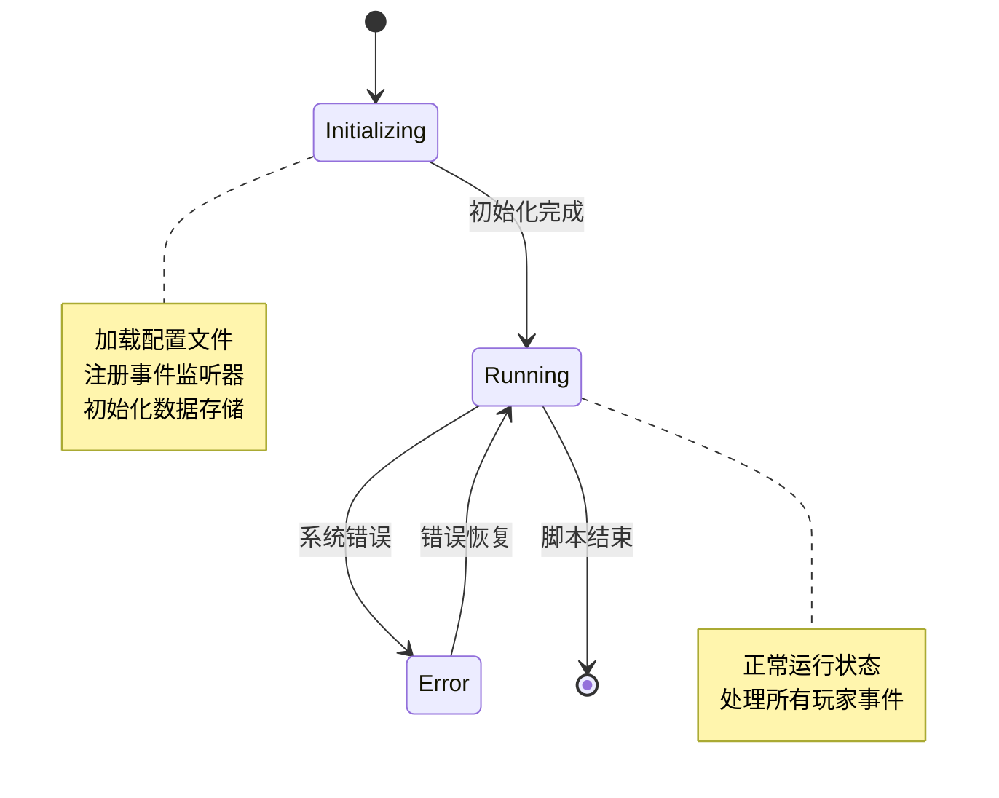

---

## 2. 玩家会话层状态机（核心层）

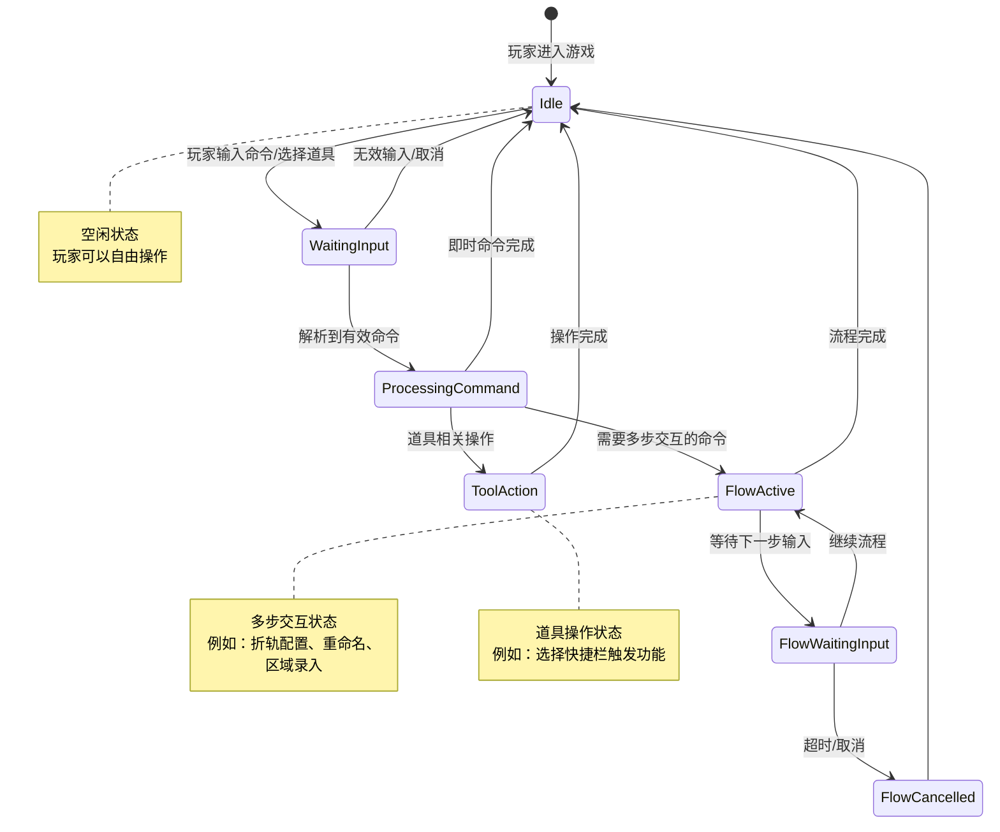

---

## 3. 功能模块层状态机

### 3.1 音调方块生成模块

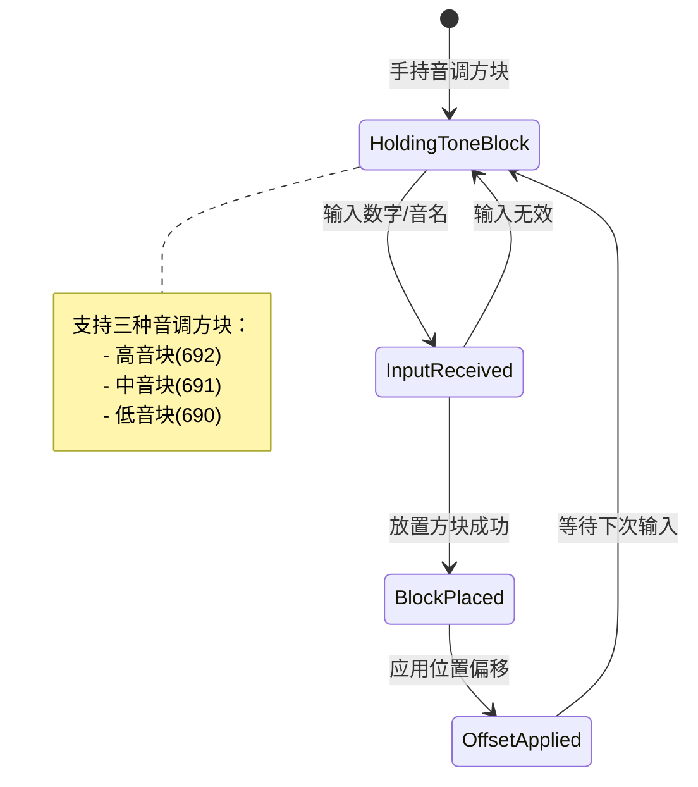

### 3.2 乐器方块生成模块

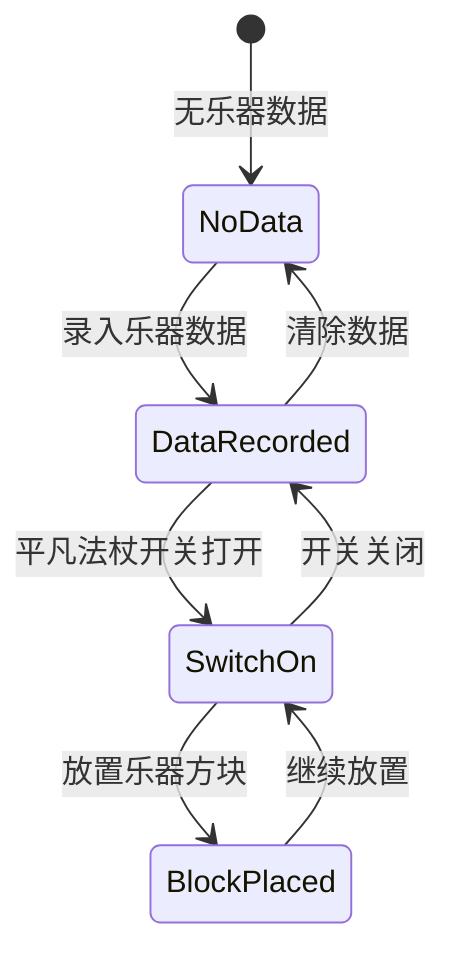

### 3.3 乐器刷子模块

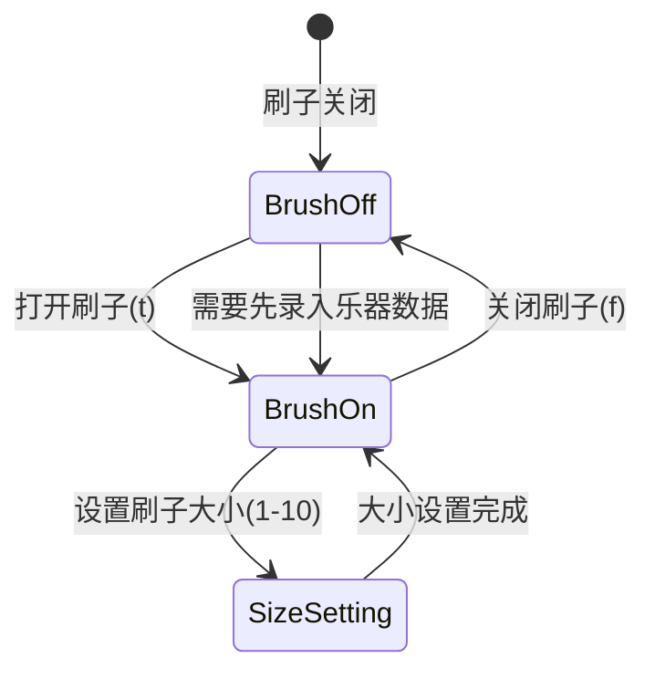

### 3.4 区域复制粘贴模块

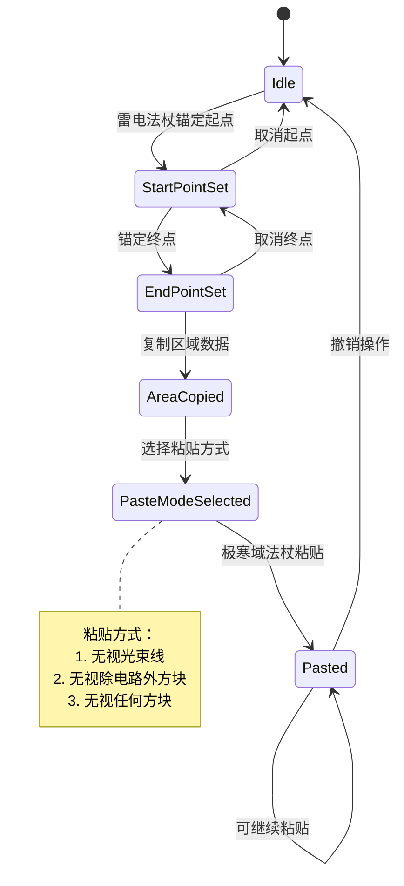

### 3.5 Pattern管理模块（复苏法杖）

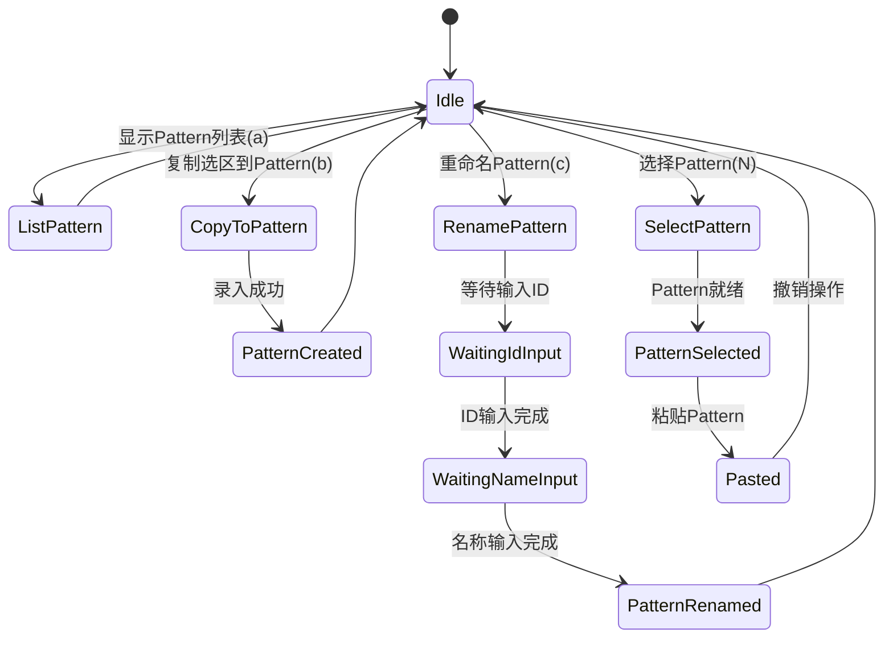

### 3.6 折轨配置模块（多步交互）

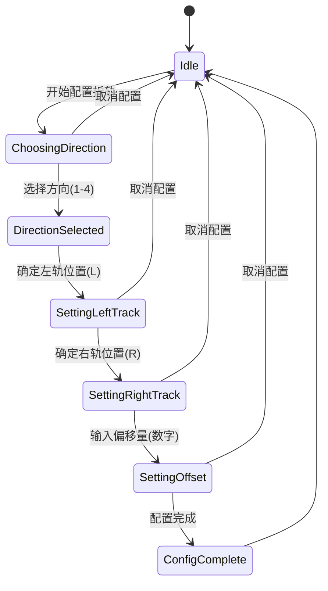

### 3.7 全局设置模块（收割者）

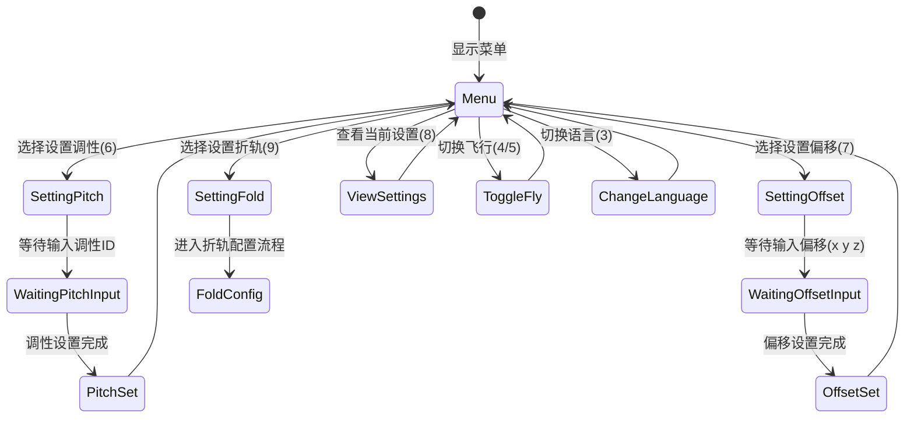

### 3.8 小节标记模块（石箭）

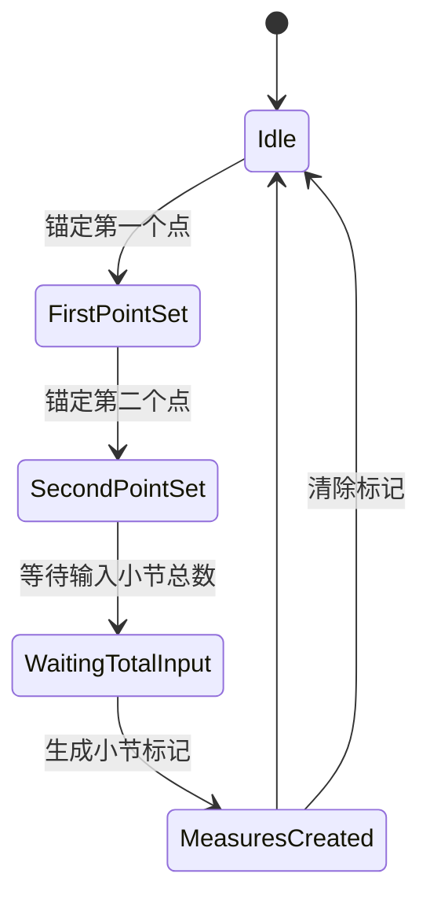

### 3.9 封轨/拆轨模块（脉冲箭）

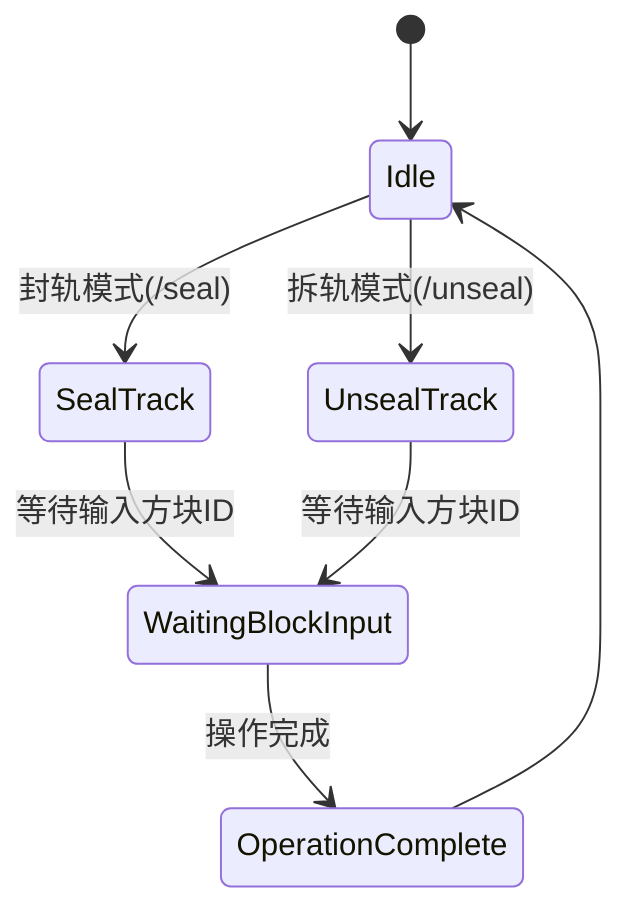

---

## 4. 命令路由层状态机

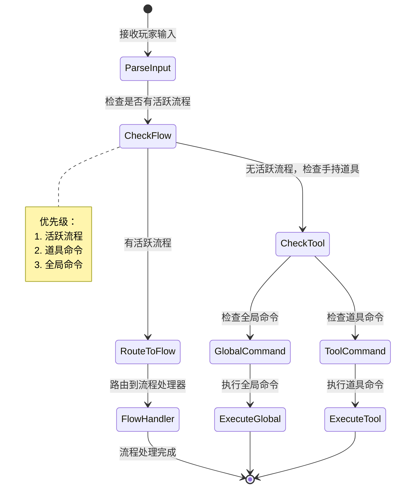

---

## 5. 完整状态流转示例

### 示例1：折轨配置完整流程

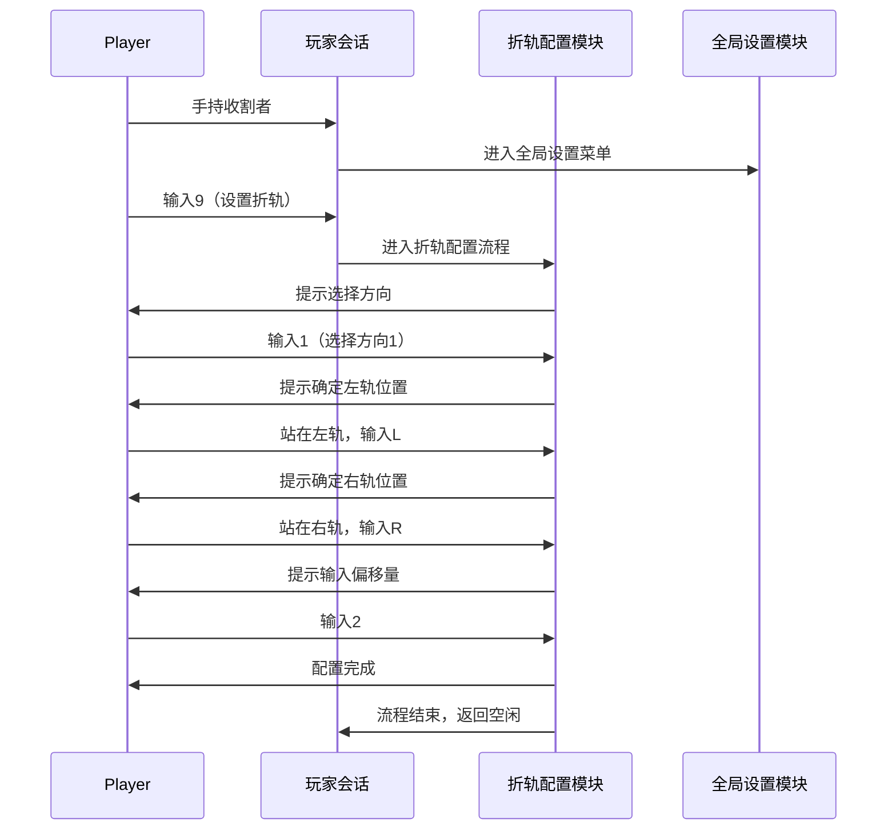

### 示例2：Pattern重命名流程

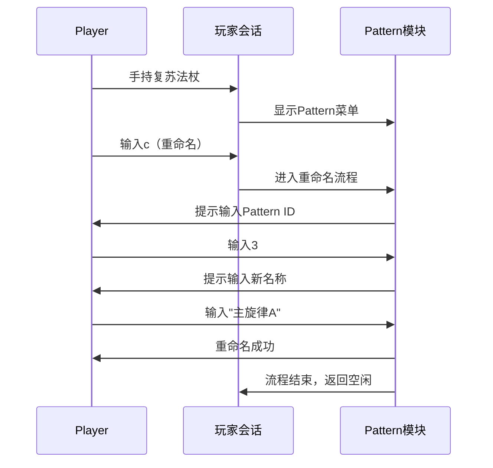

---

## 6. 状态机实现要点

### 6.1 状态定义规范

每个状态包含：
- **状态名称**：唯一标识符
- **进入动作**：进入该状态时执行
- **退出动作**：离开该状态时执行
- **转换条件**：触发状态转换的条件和动作
- **超时处理**：长时间无响应时的处理

### 6.2 状态持久化

- 玩家会话状态保存在 `PDB[UIN]` 中
- 流程状态包含：流程名称、当前步骤、数据上下文、超时时间戳
- 支持状态恢复和超时清理

### 6.3 状态转换规则

1. **优先检查活跃流程**：如果有活跃流程，输入优先路由到流程处理器
2. **工具命令优先级**：手持道具时，工具命令优先于全局命令
3. **状态清理**：流程超时或玩家切换道具时，自动清理相关状态
4. **状态隔离**：不同玩家的状态完全隔离，互不干扰

---

## 7. 模块划分建议

基于状态机设计，建议的模块结构：

```
Core/
  ├── StateMachine.lua          # 状态机核心引擎
  ├── PlayerSession.lua         # 玩家会话管理器
  └── CommandRouter.lua         # 命令路由器

Modules/
  ├── ToneBlockGenerator.lua   # 音调方块生成
  ├── InstrumentBlock.lua      # 乐器方块生成
  ├── Brush.lua                # 乐器刷子
  ├── AreaCopyPaste.lua        # 区域复制粘贴
  ├── Pattern.lua              # Pattern管理
  ├── AreaPattern.lua          # AreaPAT管理
  ├── FoldConfig.lua           # 折轨配置
  ├── GlobalSettings.lua       # 全局设置
  ├── Measure.lua              # 小节标记
  ├── TrackSeal.lua            # 封轨/拆轨
  └── RailPlace.lua            # 过山车轨道

Utils/
  ├── I18N.lua                 # 国际化
  ├── Constants.lua            # 常量定义
  ├── BlockUtils.lua           # 方块操作工具
  └── Geometry.lua             # 几何计算工具

Data/
  ├── Storage.lua              # 数据存储管理
  └── Patterns.lua             # Pattern数据管理
```

---

## 8. 关键设计决策

1. **分层架构**：全局 → 玩家会话 → 功能模块 → 命令路由，职责清晰
2. **流程化交互**：多步操作统一用流程状态机管理，避免状态散乱
3. **工具驱动**：按手持道具切换命令集，符合原设计逻辑
4. **状态隔离**：每个玩家独立状态机，支持联机
5. **超时保护**：所有流程都有超时机制，防止状态卡死
6. **扩展性**：新增功能只需添加新的子状态机，不影响现有逻辑

---

## 9. 迁移策略

1. **保持数据兼容**：`PDB[UIN]` 结构尽量保持兼容，逐步迁移
2. **功能对等**：确保所有原功能都能在新架构中实现
3. **渐进式重构**：先实现核心状态机框架，再逐个迁移功能模块
4. **测试验证**：每个模块迁移后，进行完整功能测试

